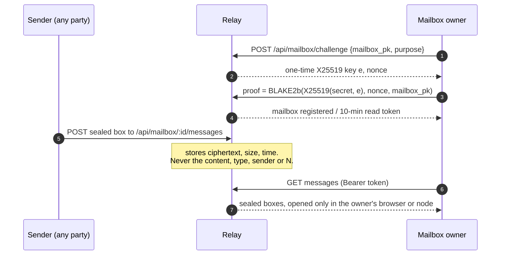

<p align="center">
  <a href="https://jitsuinfi.vercel.app"></a>
</p>

<p align="center">
  
  
  
  
  
</p>

<p align="center">
  <b>The relay: sealed mailboxes that carry deal documents between supplier, buyer and financier. It only ever holds ciphertext.</b>
</p>

<p align="center">
  <a href="https://jitsuinfi.vercel.app"><b>Landing</b></a> ·
  <a href="https://jitsuinfi.vercel.app/app"><b>App</b></a> ·
  <a href="https://jitsuinfi.vercel.app/try"><b>Try to double-finance</b></a> ·
  <a href="https://jitsuinfi.vercel.app/verify"><b>Verify</b></a> ·
  <a href="https://jitsuinfi-console-demo.vercel.app/console"><b>Console demo</b></a> ·
  <a href="https://youtu.be/RB9hKSLarJo"><b>2-min video</b></a>
</p>

<p align="center">
  <a href="https://youtu.be/RB9hKSLarJo"></a>
  <br><sub>Two minutes: the idea, a double-financing attempt caught live on the testnet board, and a whole deal from supplier to settlement.</sub>
</p>

Relay for **JitsuinFi**: encrypted mailboxes that carry deal documents between supplier, buyer and financier (HNK-23). The relay stores only what it must: each mailbox's X25519 key and id, opaque sealed messages with their size and times, one-time challenges and short read tokens. It never sees a document, a key or an IP address in its tables.

The browser reaches it as `/api/*` on the web app's own origin (Vercel rewrite, HNK-23.T6), so the app's CSP stays `connect-src 'self'`. The database is Supabase Postgres, reached only from this server (D-33).

<table>
  <tr>
    <td width="50%" valign="top"><br><b>What travels through the relay</b><br><sub>The supplier writes on a phone; the invoice lands sealed in the buyer's inbox; one passkey touch signs it and the signature travels back, all as ciphertext.</sub></td>
    <td width="50%" valign="top"><br><b>Inboxes on both sides</b><br><sub>Repeat invoices on production: the supplier's inbox says the buyer's key is free again, the buyer's shows the second deal settled.</sub></td>
  </tr>
</table>

## What the relay can and cannot see

| The relay **sees** | The relay **never sees** |
|---|---|
| each mailbox's public X25519 key and id | any document, invoice, amount or party |
| sealed messages: size, received and expiry time | the message type, the sender, the fingerprint N |
| one-time challenges, short read tokens | a key, a passkey or an IP address in its tables |
| one sealed state blob per mailbox (multi-device sync) | what is inside it: AES-GCM under a passkey key, sealed to the owner |

## Ownership proof and delivery



## Protocol

- `mailbox_id = BLAKE2b-512("JitsuinMailboxId_v1\n" ‖ mailbox_pk)[0..32]`, hex. The relay computes it from the key, so its id always matches the client's.
- **Ownership proof** (register, read): the relay makes a one-time ephemeral X25519 key `e` and a 32-byte nonce. The owner answers
  `BLAKE2b-512("JitsuinMailboxProof_v1\n" ‖ purpose ‖ 0x00 ‖ X25519(mailbox_secret, e_pk) ‖ nonce ‖ mailbox_pk)[0..32]`.
  Only the holder of the mailbox secret can compute it; knowing `mailbox_id` or `mailbox_pk` is not enough. Low-order keys are refused.
- Messages are sealed boxes to the recipient's `mailbox_pk` (made in the browser by jitsuin-wasm, HNK-23.T2), at most `9 + 64 KiB + 2 × 2 MiB` plaintext plus 48 bytes. Their format and signatures (`JTSM`, jitsuinfi-frontend `src/lib/relay-message.ts`) are checked by the recipient, not here.

| Method | Path | Body | Answer |
|---|---|---|---|
| POST | `/api/mailbox/challenge` | `{mailbox_pk, purpose: "register" \| "read"}` | `{challenge_id, eph_pk, nonce, expires_at}` (120 s, single use) |
| POST | `/api/mailbox` | `{mailbox_pk, challenge_id, proof}` | `201 {mailbox_id, created: true}`, or `200` when it exists |
| POST | `/api/mailbox/:id/read` | `{challenge_id, proof}` | `{token, expires_at}` (10 min) |
| POST | `/api/mailbox/:id/messages` | sealed box, `application/octet-stream` | `202 {message_id, expires_at}`; anyone may send |
| GET | `/api/mailbox/:id/messages` | `Authorization: Bearer <token>` | `{messages: [{id, size, received_at, expires_at}]}` |
| GET | `/api/mailbox/:id/messages/:mid` | Bearer | the sealed box |
| DELETE | `/api/mailbox/:id/messages/:mid` | Bearer | `204` |
| PUT | `/api/mailbox/:id/state` | Bearer, sealed box (`application/octet-stream`, at most 64 KiB + 48) | `{updated_at}`; replaces the owner's state |
| GET | `/api/mailbox/:id/state` | Bearer | the owner's sealed state, or `204` (no body) when none was saved |

Messages expire after `RETENTION_DAYS` (30); a mailbox holds at most `MAX_MESSAGES_PER_MAILBOX` (200) unread messages. Errors are `{error}` with a readable sentence.

The **state** (HNK-25.T2) is one sealed blob per mailbox that only its owner writes and reads, kept until the owner replaces it, so a second device signed in with the same passkey gets the account's records back. The web app writes each role's records there (invoices, deals, keys handed out, contacts and the buyer's history chain; jitsuinfi-frontend `src/lib/sync.ts`): AES-GCM under a key from the passkey, inside a seal to the owner's own mailbox key. The relay sees its size and time only, and `GET` answers `204` while nothing is saved. It cannot read, forge or edit a record; it can only withhold or roll the state back, and the buyer's history chain is checked against the browser's own copy and the next certificate's tag on the board.

## Run

Node 22.18 or later (runs TypeScript directly).

```bash
npm install
cp .env.example .env   # then fill DATABASE_URL yourself; never paste it in chat or commit it
npm run migrate        # creates the relay_* tables in that database
npm start              # :8787; without DATABASE_URL it keeps everything in memory
```

`npm test` runs the API against an in-memory store, and against Postgres when `TEST_DATABASE_URL` is set. `npm run typecheck` checks the types.

## Deploy on Railway (HNK-23.T5, after approval)

<details>
<summary>Open the reference</summary>

`railway.json` builds with Railpack on Node 24 (`.node-version`), runs `npm run migrate` before each deploy (idempotent), starts with `npm start` and checks `/api/health`. The relay also applies the same `db/*.sql` when it starts on Postgres and refuses to start if it cannot, so a deploy whose pre-deploy step did not run never serves an older schema (a missing table would otherwise answer 503).

1. Railway: New project → Deploy from GitHub repo → `JitsuinFi/jitsuinfi-backend`, branch `main`.
2. Variables: `DATABASE_URL` = the Supabase **Session pooler** URI (below). `PORT` is set by Railway. Optional: `RETENTION_DAYS`, `MAX_MESSAGES_PER_MAILBOX`, `CHALLENGE_TTL_SECONDS`, `READ_TOKEN_TTL_SECONDS`.
3. Networking → Generate domain. The web app reaches it through a Vercel rewrite of `/api/*` (HNK-23.T6), never directly.

`DATABASE_URL` from Supabase: Connect → Connection string → URI → Method **Session pooler**:
`postgresql://postgres.<project-ref>:<database-password>@aws-0-<region>.pooler.supabase.com:5432/postgres`.
Session pooler, because the direct connection is IPv6 only and Railway connects over IPv4; port 5432 (session mode), because `postgres` uses prepared statements. The password is the database password (Project Settings → Database), not an API key. No Supabase API keys (anon, publishable, secret, service role) are used: the relay talks to Postgres only, and the browser never talks to Supabase (D-33).

Status: in development for ZECATHON 2026, on Zcash testnet.

</details>

<p align="center"></p>

## License

Licensed under either of [Apache License, Version 2.0](LICENSE-APACHE) or [MIT license](LICENSE-MIT), at your option. Unless you explicitly state otherwise, any contribution you submit for inclusion in this work, as defined in the Apache-2.0 license, is dual licensed as above, without any additional terms or conditions.
